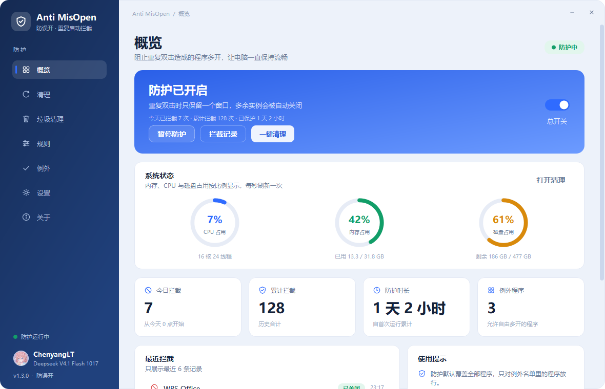
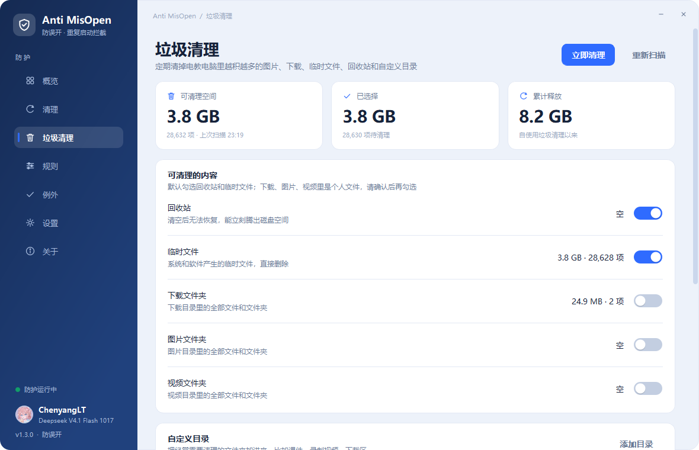
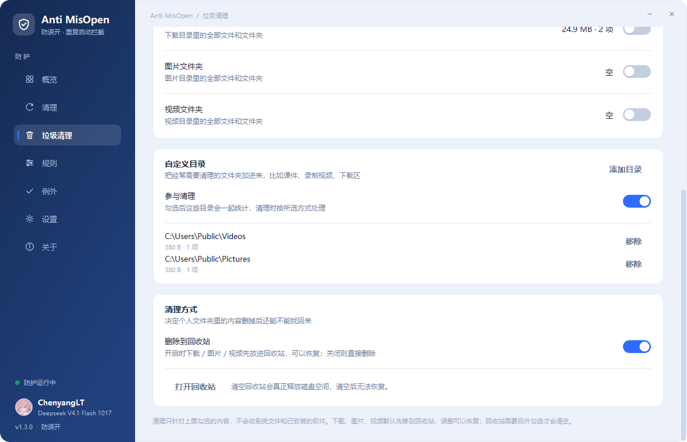
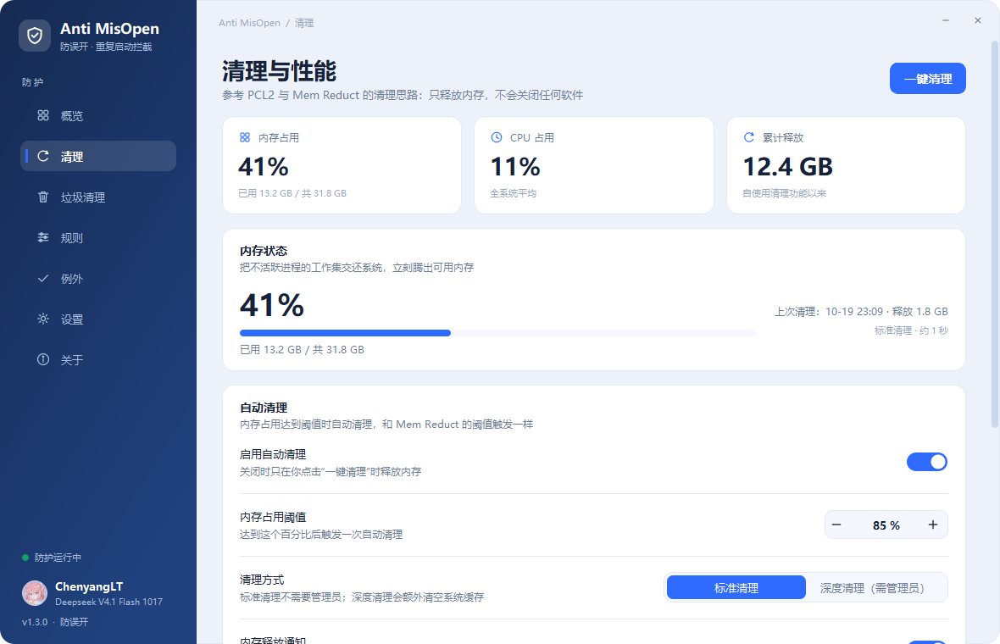
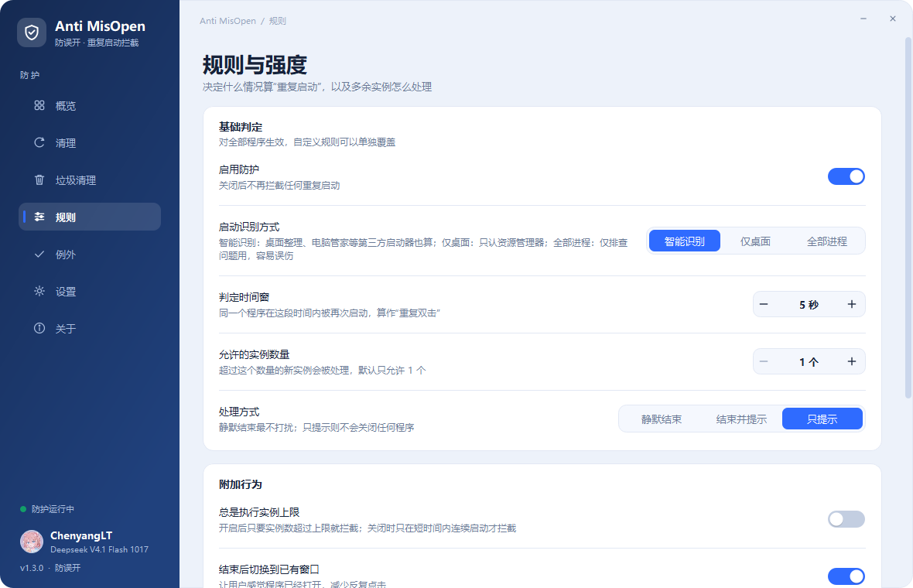
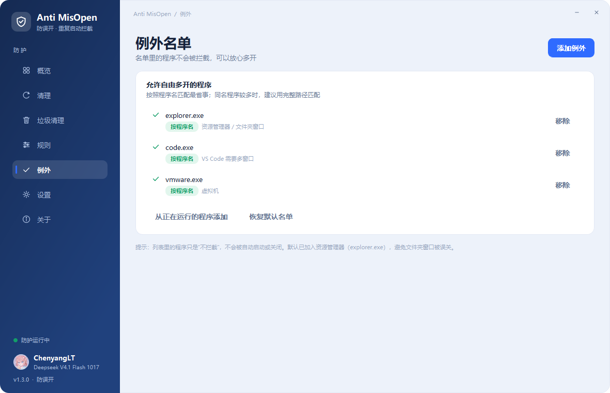
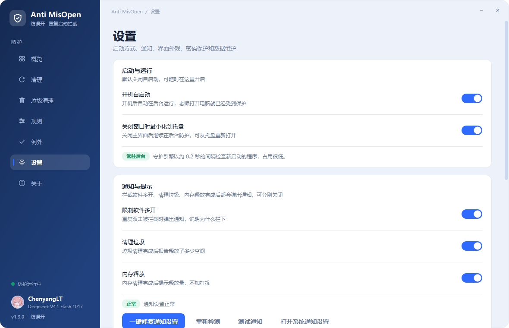
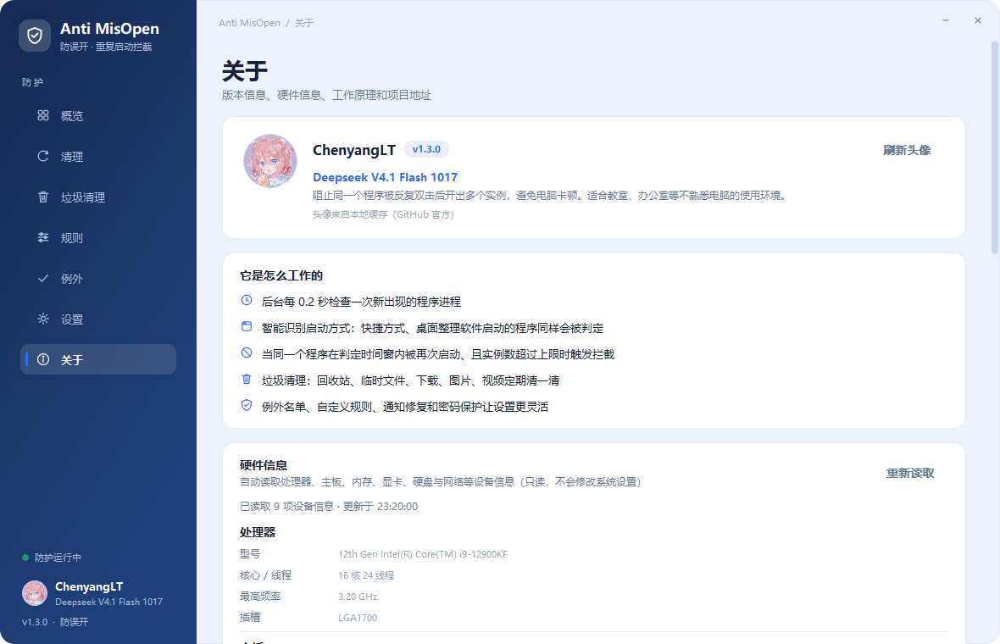
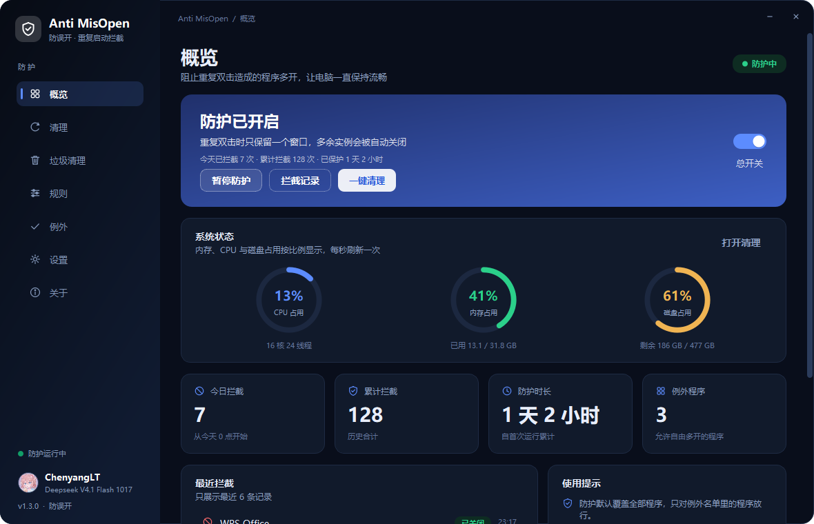

# Anti MisOpen · 防误开

> 阻止“重复双击”把同一个软件开出好几个窗口，让不熟悉电脑的老师也能一直用到流畅的电脑。

## 这个软件解决什么问题

很多人习惯“双击没反应就再双击一次”，结果同一个程序被打开了 3、4 个窗口：内存被占满、电脑卡死、任务栏挤成一片。
**Anti MisOpen（防误开）** 在后台盯着新启动的程序：如果同一个程序在很短时间内被连续启动、实例数超过上限，就自动结束多出来的那个窗口，并把已经打开的窗口切到前面——用户看到的效果就是“程序已经打开了”，不会再反复点。

- 老师不需要学任何新操作，正常双击即可。
- 默认只允许 1 个实例，判定时间窗默认 5 秒（都可改）。
- 不做驱动、不装服务、不要管理员权限，普通用户双击 exe 就能用。

## 功能特性

| | |
| --- | --- |
| **重复启动拦截** | 同一程序在判定时间窗（默认 5 秒）内被再次启动、且实例数超过上限时拦截；之后正常间隔的再次启动不受影响。 |
| **启动识别方式** | 智能识别（默认，兼容桌面整理 / 电脑管家 / 第三方启动器拉起的快捷方式）、仅桌面（只认资源管理器）与全部进程三种模式，遇到漏判可随时切换。 |
| **实时系统状态** | 概览页用三个环形图按比例显示 CPU、内存、磁盘占用，每秒刷新，一眼看出电脑是不是变卡了。 |
| **硬件信息** | 关于页自动读取处理器、主板、BIOS、内存、显卡、硬盘分区、显示器、网卡与系统版本（只读 WMI，不修改系统设置）。 |
| **三种处理方式** | 静默结束 / 结束并提示 / 只提示不结束，可全局设置，也可对单个程序单独设置。 |
| **例外名单** | 名单里的程序永远不被拦截（默认已放行 explorer.exe，避免文件夹窗口被误关）。可从正在运行的程序里一键添加。 |
| **自定义规则** | 针对某个程序单独设置时间窗、实例上限、处理方式，例如允许 Chrome 最多 3 个窗口。 |
| **切回已有窗口** | 结束多余实例后自动把已打开的窗口激活到最前，体验上就像“程序本来就已经打开了”。 |
| **开机自启动（默认关闭）** | 在设置里一键开启，写入当前用户的 Run 注册表项，不需要管理员权限。 |
| **密码保护** | 可设置密码，防止别人关闭防护、暂停防护或退出程序；默认无密码。 |
| **最小化到托盘** | 关闭主窗口后继续在后台防护，可从托盘重新打开或退出。 |
| **四种主题** | 浅色蓝（默认）、深色霓虹、护眼绿、跟随系统，随时切换立即生效。 |
| **拦截记录** | 每次拦截都会记录程序名、原因、时间，可随时查看与清空。 |
| **一键内存清理** | 参考 PCL2 / Mem Reduct 的清理方式：让不活跃的进程交还工作集，点一下就能腾出内存，不会关闭任何软件。 |
| **阈值自动清理** | 内存占用达到阈值（默认 85%）时自动清理，两次清理至少间隔 5 分钟，可选手动/深度清理模式。 |
| **垃圾清理** | 单独一页清理电教电脑里越积越多的内容：回收站、临时文件，以及可选的下载、图片、视频文件夹；默认只勾选回收站与临时文件，清理前可先看占用大小。 |
| **自定义目录** | 把课件、录制视频、下载区等任意文件夹加进垃圾清理，每个目录单独显示占用大小与文件数量，可随时移除；目录内容不会被自动打开或上传。 |
| **保留最近文件** | 点「立即清理」时会询问清理方式：全部清除 / 只清掉 7 天以前的文件 / 取消。选保留时按文件修改时间判断，个人目录里最近的文件不会被误删，回收站不支持按时间筛选会保持不动。 |
| **三类通知开关** | 限制软件多开、清理垃圾、内存释放完成后都会弹出通知，默认全部打开，可在「设置 → 通知与提示」里分别关闭。 |
| **GitHub 作者信息** | 关于页与左下角自动获取 GitHub 头像与 ID（先试镜像站，失败再试官方地址，成功一次就缓存到本地），下方标注模型名，断网时显示占位头像与缓存信息。 |
| **触屏优化** | 滚动条加宽并让出窗口边缘判定，手指按住右侧滚动条拖动时只滚动、不会误触发窗口缩放；普通鼠标操作不受影响。 |
| **一键修复通知** | 拦截提示弹不出来时，设置页「一键修复通知设置」会检查并修复系统通知开关、应用通知权限、气球提示与通知服务，并发送一条测试通知。 |

### 界面预览

| 垃圾清理 | 自定义目录 |
| --- | --- |
|  |  |

| 清理与性能 | 概览 |
| --- | --- |
|  |  |

| 规则与强度 | 例外名单 |
| --- | --- |
|  |  |

| 设置与通知 | 关于与作者信息 |
| --- | --- |
|  |  |

| 深色主题 | |
| --- | --- |
|  | |

## 更新日志

### v1.3.0（2026-10-19）

- 新增「自定义目录」：垃圾清理页可以添加任意文件夹（课件、录制视频、下载区等），逐个显示占用与文件数，可随时移除。
- 新增清理方式选择：点「立即清理」时可选「全部清除 / 只清掉 7 天以前的文件 / 取消」，保留模式按文件修改时间递归判断，嵌套文件夹里的旧文件也能清掉。
- 通知分类：限制软件多开、清理垃圾、内存释放三类通知默认开启，可在设置里分别关闭；拦截与清理完成后会按开关决定是否弹通知。
- 关于页与侧栏署名改为自动获取 GitHub 头像与 ID（镜像优先 + 本地缓存），下方标注模型名；网络不通时显示占位头像。
- 触屏优化：滚动条加宽并让出窗口边缘，拖动滚动条不再误触发窗口缩放；保留鼠标边框缩放手势。
- 修复垃圾清理「保留最近文件」对嵌套子目录无效的问题。

### v1.2.0（2026-10-19）

- 修复：桌面整理 / 电脑管家 / 第三方启动器拉起的快捷方式，连续双击时不再漏判。
- 新增「启动识别方式」：智能识别（默认）/ 仅桌面 / 全部进程，漏判或误判时可切换。
- 新增「一键修复通知设置」：检查并修复系统通知、应用通知权限、气球提示与通知服务，修复后自动发测试通知。
- 新增「垃圾清理」页：回收站、临时文件、下载、图片、视频，默认只勾选前两项，默认删除到回收站。
- 启动较慢或窗口没有标题的程序，最多等 4 秒再判定，避免漏拦。

### v1.1.0（2026-10-19）

- 概览页新增 CPU / 内存 / 磁盘环形图，每秒刷新。
- 检测间隔从 0.4 秒缩短到 0.2 秒；新增自动内存清理与累计释放统计。
- 关于页新增硬件信息（只读 WMI 读取）。
- 修复任务栏图标显示为空白的问题。

## 下载与安装

1. 到 [Releases](https://github.com/ChenyangLT/Anti-MisOpen/releases) 下载最新版 Anti-MisOpen.exe。
2. 放到任意目录（例如 D:\Tools\Anti-MisOpen\），双击运行即可，**不需要安装**。
3. 首次启动防护就是开启状态；需要开机自动运行的话，到「设置 → 启动与运行 → 开机自启动」打开。

> 程序是单文件绿色版，配置和日志保存在 %APPDATA%\AntiMisOpen\（config.json 与 logs\blocked.jsonl）。
> 卸载时删除 exe，并在设置里关闭开机自启动即可。

### 系统要求

- Windows 7 SP1 / 8 / 8.1 / 10 / 11，**64 位**。
- 无需管理员权限；如需拦截以管理员身份运行的程序，请右键“以管理员身份运行”。
- Windows 7 需要 SP1；建议把系统补丁更新到最新（部分精简版系统缺少 UCRT 运行库，可安装 KB2999226 / KB2533623）。

## 使用说明

- **总开关**：概览页右上角的开关，关闭后不再拦截任何程序。
- **暂停防护**：临时暂停 5 分钟 ~ 1 小时，或暂停到手动恢复。
- **添加例外**：「例外 → 添加例外」，可以按程序名（如 chrome.exe）或完整路径添加，也可以从“正在运行的程序”里直接选。
- **自定义规则**：「规则 → 添加规则」，给某个程序单独设置时间窗、实例上限和处理方式。
- **一键清理**：点概览页或清理页的「一键清理」，释放不活跃进程占用的内存，不会关闭任何软件；也可以在清理页开启阈值自动清理。
- **垃圾清理**：到「垃圾清理」页先「重新扫描」看占用，勾选回收站 / 临时文件（默认）或下载 / 图片 / 视频文件夹，点「立即清理」。默认删除到回收站，确认没问题后再清空回收站。
- **自定义目录**：在垃圾清理页「自定义目录」卡片点「添加目录」，选择课件、录制视频、下载区等文件夹；勾选「参与清理」后一起统计，点「移除」随时移出列表。
- **清理方式**：点「立即清理」后会弹出确认框，可选择「全部清除」或「只清掉 7 天以前的文件」。保留模式按文件修改时间判断，嵌套文件夹里的旧文件同样会被清掉，最近的文件保持不动；回收站不支持按时间筛选，保留模式下会跳过回收站。
- **通知开关**：「设置 → 通知与提示」里可以分别开关「限制软件多开」「清理垃圾」「内存释放」三类通知，默认全部打开。
- **作者头像**：关于页右上角「刷新头像」会重新获取 GitHub 头像与 ID；默认先走镜像站（学校网络也能用），成功一次就缓存到本地，断网时显示缓存或占位头像。
- **通知修复**：拦截提示弹不出来时，到「设置 → 通知与提示」点「一键修复通知设置」，修复完会自动发一条测试通知；仍不弹请检查是否开了“专注助手 / 请勿打扰”。
- **退出程序**：托盘图标右键 → 退出；如果设置了密码，退出前需要输入密码。
- **忘记密码**：关闭程序后删除 %APPDATA%\AntiMisOpen\config.json 即可恢复默认（拦截记录也会一并重置）。

## 它是怎么工作的

1. 后台线程每 0.2 秒枚举一次系统进程（psutil，只读，开销很低）。
2. 判断新进程是不是“用户主动启动的”：默认的智能识别会排除程序自己派生的子进程（父进程同名或同一安装目录）和安装 / 更新类辅助进程，其余外部启动都算用户操作；这样桌面整理、电脑管家、第三方启动器拉起的快捷方式也能识别。也可切换为“仅桌面”（只认资源管理器）或“全部进程”。
3. 统计同名程序（且可执行文件路径相同）的实例数，程序自己派生的同名子进程不计入——这样 Chrome、Electron 类软件不会被误判。
4. 当“实例数超过上限”且“距离上次启动在时间窗内”时执行处理：结束多余实例 → 激活已有窗口 → 写入拦截记录 → 托盘气泡提示。
5. 结束进程只针对当前用户有权限的进程；权限不足时会在记录里说明原因，不会强行提权。

> 启动识别方式可在「规则 → 启动识别方式」里切换：智能识别适合装了桌面整理 / 电脑管家的电脑；如果电脑上还有奇怪的启动器造成误判，可临时切到“仅桌面”。

### 通知与垃圾清理是怎么做的

- 拦截、内存清理、垃圾清理完成后都通过系统通知中心（托盘气泡）提示；三类通知在设置里各有独立开关，关闭后只是不弹提示，功能照常执行。
- 通知发不出去时，「一键修复通知设置」会检查并修复系统通知总开关、本应用通知权限、气球提示、通知服务与专注助手策略，修复完自动发一条测试通知。
- 垃圾清理只处理界面里勾选的内容：回收站用 SHEmptyRecycleBinW；临时文件来自系统临时目录与 %WINDIR%\Temp；个人目录与自定义目录默认删除到回收站（可恢复），选「保留最近文件」时改为按修改时间直接删除旧文件。

### 硬件信息是怎么读取的

- 通过系统自带的 PowerShell 调用 WMI/CIM 查询设备信息，只读，不安装驱动、不修改任何系统设置。
- 兼容 Windows 7 自带的 PowerShell 2.0；查询失败时用注册表和 psutil 兜底，界面不会因为读不到某项信息而报错。
- 读取结果缓存在 %APPDATA%\AntiMisOpen\hardware.json，下次打开关于页先显示缓存，再在后台刷新。

### 内存清理是怎么做的

- 标准清理调用 Windows 的 EmptyWorkingSet / SetProcessWorkingSetSize，只让不活跃进程把工作集交还系统，不结束、不挂起、不修改任何程序。
- 深度清理会额外尝试清空待机列表（standby list）、刷新已修改页列表、重置系统文件缓存；这些操作需要管理员权限，普通权限下会自动跳过。
- 自动清理按阈值触发，两次自动清理之间至少间隔 5 分钟，避免频繁清理反而让程序反复读盘。

## 从源码运行与打包

~~~powershell
# 1. 准备 Python 3.8（Win7 兼容线：PySide2 5.15 + PyInstaller 5.13）
uv venv --python 3.8 .venv38
uv pip install --python .venv38\Scripts\python.exe --index-url https://pypi.tuna.tsinghua.edu.cn/simple pyside2==5.15.2.1 psutil pyinstaller==5.13.2

# 2. 源码运行
.venv38\Scripts\python.exe run.py

# 3. 生成图标与界面截图（可选）
.venv38\Scripts\python.exe tools\make_icon.py
.venv38\Scripts\python.exe tools\screenshot.py

# 4. 打包单文件 exe（产物 dist\Anti-MisOpen.exe）
powershell -ExecutionPolicy Bypass -File .\build.ps1
~~~

项目结构：

~~~
app/
  core/      配置、主题、规则匹配、进程守护引擎、内存清理、垃圾清理、通知修复、硬件信息、作者头像、开机自启、日志
  ui/        主窗口、侧边导航、七个页面、对话框、自绘图标与控件
  main.py    入口：单实例、DPI、字体、异常兜底
run.py       打包入口
tools/       图标生成、界面截图、版本资源（version_info.txt）
assets/      应用图标（ico/png）
screenshots/ README 用界面截图
~~~

## 常见问题

**为什么有的程序没有被拦？**
为了不误伤系统，以下情况会跳过：系统进程、安装 / 更新程序、C:\Windows 与 WindowsApps 里的组件、程序自己派生的子进程（父进程同名或同一安装目录），以及例外名单中的程序。如果快捷方式是由桌面整理、电脑管家等第三方工具打开的，默认的“智能识别”已经能识别；仍漏判时可在「规则 → 启动识别方式」切换。

**会不会把正常操作拦掉？**
默认只处理“极短时间内的重复启动”。如果确实需要多开（比如 VS Code 多窗口、虚拟机），把它加入例外名单即可。

**结束进程会不会丢数据？**
只会结束“刚刚被重复启动的多余实例”，已经打开并保存过内容的窗口不受影响；但仍建议重要文档随手保存。

**通知弹不出来怎么办？**
先到「设置 → 通知与提示」点「一键修复通知设置」，它会检查系统通知总开关、本程序的通知权限、气球提示、通知服务与专注助手策略；修复后会自动发一条测试通知。如果系统开了“专注助手 / 请勿打扰”，通知会被静默，需要手动关闭。

**垃圾清理会删掉我的文件吗？**
默认只勾选回收站与临时文件；下载、图片、视频属于个人文件，默认不勾选，需要自己确认后才会处理。清理默认“删除到回收站”（临时文件除外），误删可以从回收站还原。

**「保留 7 天内的文件」是怎么算的？**
按文件的修改时间递归判断：7 天内改过的文件保留，更早的删除（嵌套子文件夹里的也会清），删完再自底向上清掉空目录。自定义目录本身不会被删除，只会清里面的内容。

**头像加载不出来怎么办？**
程序会依次尝试 ghproxy.net、ghfast.top、gh-proxy.com 三个镜像，最后才试 GitHub 官方地址，成功一次就缓存在 %APPDATA%\AntiMisOpen\avatar.png。都失败时显示内置占位头像与「离线模式」，不影响其它功能；联网后点关于页右上角「刷新头像」即可重试。

**内存清理会关闭我的软件吗？**
不会。清理只影响进程的工作集（闲置内存页），不结束进程、不修改程序；正在使用的程序会在需要时自动重新载入页面。

**读取硬件信息会修改系统吗？**
不会。硬件信息通过 WMI 只读查询，只用于在「关于」页展示；结果缓存在本地配置目录，不会上传到任何地方。

**为什么不需要管理员权限？**
程序只结束当前用户启动的进程，并写入当前用户的注册表启动项；除非要拦截管理员权限运行的程序，否则不需要提权。

**支持 Windows 7 吗？**
支持 64 位 Windows 7 SP1：使用 Python 3.8 + Qt 5.15 + PyInstaller 5.13 构建，这是最后一代官方支持 Win7 的组合。程序会自动检测系统是否启用桌面合成，未启用时使用不透明窗口，避免四角黑块。

## 署名

**Chen_yang_ & Deepseek V4.1 Flash 1017 Ver.**

关于页与左下角显示的作者头像 / ID 会自动从 GitHub（[ChenyangLT](https://github.com/ChenyangLT)）获取，并缓存到本地。

## License

[MIT](LICENSE) © 2026 ChenyangLT
